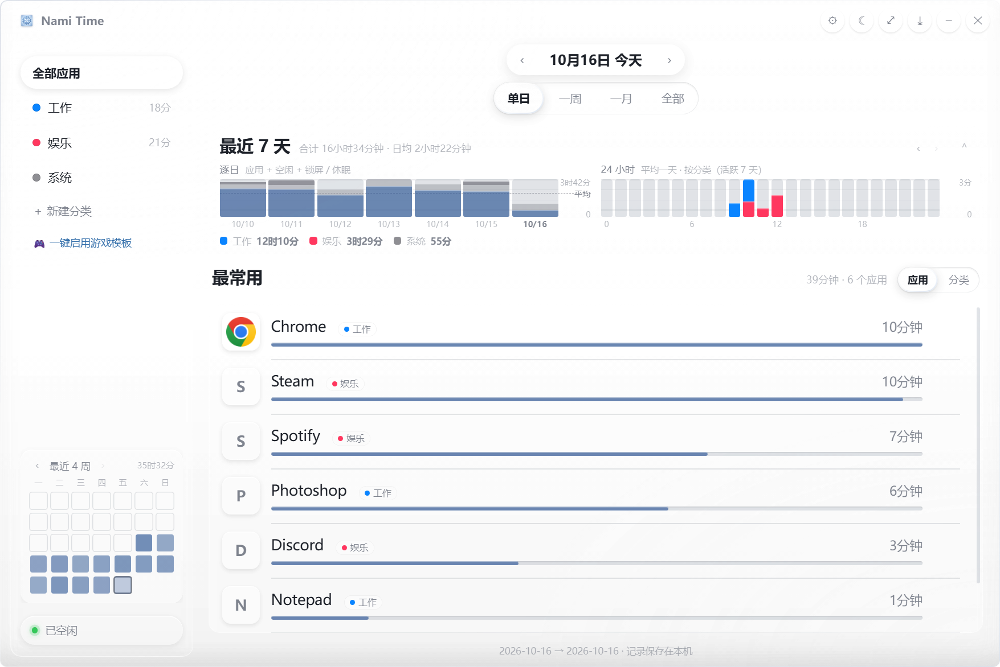
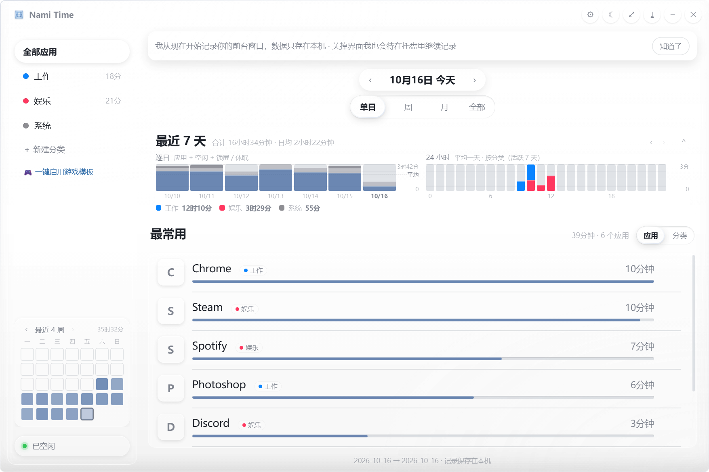

# Nami Time

> 极简的 Windows 前台应用时长记录器 —— 数据只存在本机，不联网、不上传、无遥测。

替代 ManicTime 的自用小工具：每秒采样一次前台窗口，告诉你「时间都去哪了」。
Electron + 原生 HTML/CSS/JS，零框架、零运行时依赖（原生模块只有 koffi 与 Node 内置的 `node:sqlite`）。

**下载**：[最新版 Release](https://github.com/Zany2020/Nami-time-tracker/releases/latest) —— 便携版（双击即用）或安装版（带快捷方式与卸载入口）。



## 功能

- **前台时长记录**：每秒采样前台窗口，空闲 / 锁屏 / 休眠单独区分，可暂停与继续
- **多范围视图**：单日 / 一周 / 一月 / 全部；「最近 7 天」逐日柱、「24 小时」分布、「最常用」排行
- **应用详情页**：点任一应用看逐日小柱图（7 天 / 30 天 / 全部），含空闲与锁屏区分
- **分类与规则**：自定义分类 + 规则引擎（按 exe 名 / 产品名匹配），内置「一键启用游戏模板」
- **热力图日历**：最近 4 周与月视图，有记录的日子带小圆点，点格子直接跳日期
- **托盘常驻**：关闭界面只是销毁渲染进程（省内存），采集留在托盘继续；托盘菜单可暂停 / 继续 / 退出
- **外观**：浅色 / 深色 / 跟随系统，玻璃通透度与图标大小可调
- **导入 ManicTime 历史**：只读 `ManicTimeReports.db` 把历史并入本库（命令行参数，见下）
- **定期备份**：全量快照（可导入）+ CSV + 每周概览图
- **开机自启**：启动文件夹里放一枚快捷方式（带 `--boot`，开机只驻托盘不弹窗），设置里可开关
- **单实例**：同一个数据目录绝不会有第二份在跑（重复启动会把已有窗口叫回来）

## 安装

Windows 10 / 11 · x64。

| 方式 | 说明 |
| --- | --- |
| **便携版** | 下载 `NamiTime-<版本>-portable.exe` 双击即用，不写注册表、不建快捷方式 |
| **安装版** | 下载 `NamiTime-<版本>-setup.exe`，可选安装目录，自动建桌面 / 开始菜单快捷方式 |
| **源码运行** | `npm install` 后双击 `启动 Nami Time.bat`（需要 Node 22+ 与 Electron） |

首次启动会在界面顶部给你一句话说明（只弹一次，点「知道了」就再也不出现）：



**卸载不会删除你的历史数据。**

> 上面两张图用的是完全虚构的演示数据（Chrome / Steam / Spotify…），不是任何人的真实使用记录。

## 数据与隐私

- 全部数据在 `%LOCALAPPDATA%\NamiTime\`（`data.db` + 备份目录），**不上传任何东西**，程序里没有任何网络请求
- 图标按内容寻址缓存在数据目录的 `icons\` 里；界面不发外部请求，字体与图标都是本地的
- 想彻底清干净：退出程序 → 删掉 `%LOCALAPPDATA%\NamiTime\` 即可
- 退出 / 卸载都不会替你删这个目录（`deleteAppDataOnUninstall: false` 是有意的）

## 从源码构建

```bat
npm install
npm run dist            :: 便携版 + 安装版一起打，产物在 dist\
npm run dist:portable   :: 只打便携版
npm run dist:installer  :: 只打安装版
```

打包要点（`package.json` 的 `build` 段）：`asar` 开启，但 **`node_modules/koffi` 必须解包**
（`asarUnpack`），否则原生模块在 asar 里加载不了；图标用 `assets/icon.ico`；
NSIS 走非一键模式、允许改安装目录、`deleteAppDataOnUninstall: false`。

## 命令行参数（开发 / 排错用）

| 参数 | 作用 |
| --- | --- |
| `--data-dir=<绝对路径>` | 换一个数据目录（QA 用；带这个参数的实例不抢单实例锁） |
| `--boot` | 只起托盘、不建窗口（开机自启用） |
| `--shot=<png>` `--shot-delay=ms` `--shot-exit` | 截图后退出（界面回归用） |
| `--probe=<js>` `--exec-js=<js>` | 在渲染进程里跑一段探针脚本 |
| `--selftest-tray` | 托盘自检（创建 / 菜单 / 关窗后仍在 / 重开窗口） |
| `--migrate=<ManicTimeReports.db>` | 导入 ManicTime 历史（默认拒绝写真数据目录，需 `--migrate-allow-real`） |
| `--lock-test` | 强制走单实例抢锁这条路（用来验证「第二份会自己退出」） |

## 目录结构

```
nami-time/
  package.json          scripts.start + build 段（electron-builder）
  启动 Nami Time.bat     源码入口（双击这个）
  assets/               图标（icon.png / icon.ico / tray.png）
  src/main/             主进程、preload、窗口圆角与深色标题栏
  src/collector/        koffi 取前台窗口、node:sqlite 存取、图标缓存、采集循环、ManicTime 导入
  src/ui/               index.html / style.css / app.js（无框架）
  tools/                数据自检与探针小工具
```

## 许可证

[MIT](LICENSE) © 2026 Zany2020 —— 随便用、随便改、随便发，保留版权声明即可。
